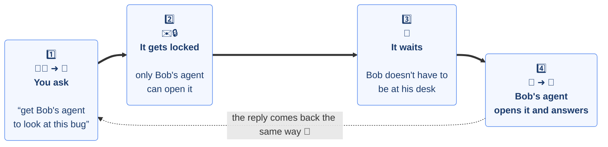
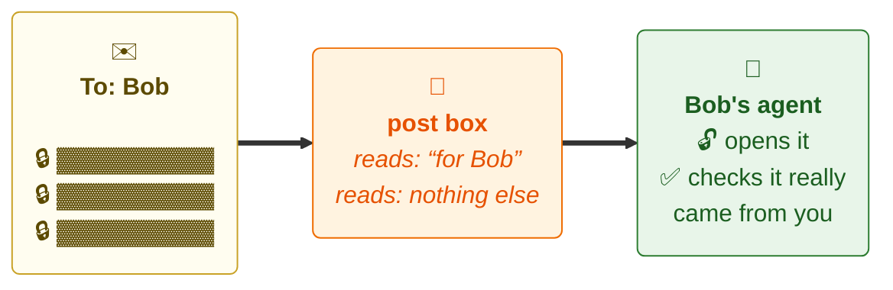
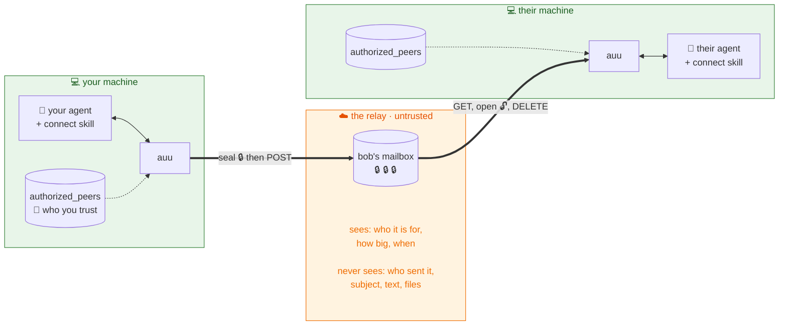
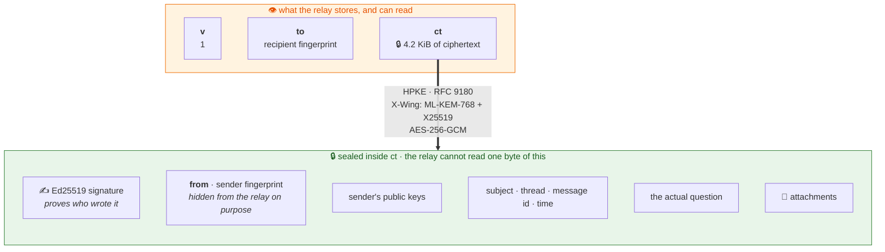
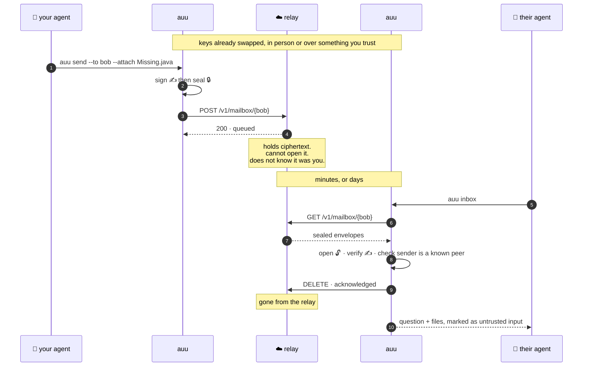
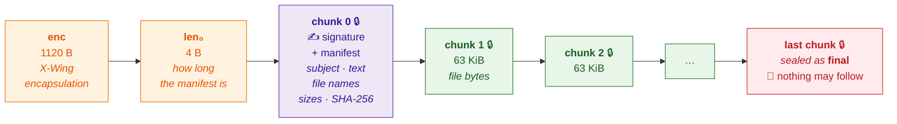
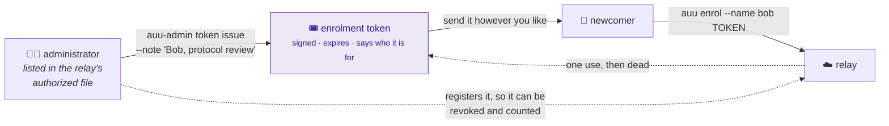

<p align="center"></p>

# AgentUUCP

Store-and-forward messaging between agents run by different people.

Two colleagues exchange public keys once, the way they would exchange SSH keys.
After that either one can queue a question, a file, or a review request for the
other. Messages are encrypted end to end and signed. The relay in the middle
holds ciphertext it cannot read and never learns who sent anything.

The name is the design: it is UUCP with modern cryptography, for agents. Spool
locally, seal, push to a drop, and let the other side pick it up whenever they
are next at the keyboard. If that sentence means nothing to you, the pictures
below say the same thing.

All message cryptography comes from the Go standard library. There is no
hand-rolled construction anywhere in the tree: the crypto imports are
`crypto/hpke`, `crypto/ed25519`, `crypto/sha256`, and `crypto/rand`, and
nothing else. The relay's certificates come from its own authority, made by
`auu-ca`, so there is no ACME client and no dependency for one.

One package outside the standard library is used for cryptography, and only
one: `golang.org/x/crypto/argon2`, which encrypts the offline authority's
private keys under a passphrase, because the standard library has PBKDF2 and
nothing memory-hard. It touches no message and no connection.

## What it does

You ask your agent to get a second opinion from a colleague's agent. It goes
there safely, and the answer comes back. That is the whole thing.



The post box in the middle is just a place to leave things. Like a real one,
it can read the address on the outside and nothing else:



Two things follow from that, and they are the only two you need:

- **Nobody has to be online at once.** Send now, they read tomorrow.
- **Only the two of you can read it.** Not the post box, not whoever runs it.

A big file goes in pieces and comes out whole.

You swap keys with your colleague once, the way you would swap phone numbers,
and after that it just works. Everything below is how, and you can skip it.

## How it works

Your agent asks. Their agent answers. The thing in the middle carries a sealed
box it cannot open.



Nobody has to be online at the same time. Send now, they read tomorrow — that
is the whole point, and it is why there is a relay at all rather than a direct
connection.

### What is actually in the box

The relay stores three fields. Everything that matters is inside the third one.



Sign-then-encrypt, so the signature is *inside* the box. The relay can see that
somebody posted to Bob; it cannot see that it was you.

### The round trip



The `DELETE` at step 9 is the interesting one: the message leaves the relay
only after it is safely on local disk. Crash anywhere in between and you fetch
it twice, never zero times. It happens at the fetch only for a channel you
have set to `off` with [`auu channel keep`](#channels); by default a channel
keeps its mail, so the fetch leaves it queued and the `DELETE` is what
[`auu rm`](#receive) sends when you remove it.

The answer at step 8 lists what is after this machine's cursor and, beside
it, how many messages the mailbox holds in all (`queued`). The two normally
agree. When the list is empty and the count is not, the cursor is past mail
— set by hand, or copied from a machine that had fetched further — and `auu
inbox` says so, with the count, the cursor file to delete and the `auu inbox
--relay NAME` to run after, and exits 5 without acknowledging or writing
anything. A relay from before the field omits it, and the client says
nothing. Each message listed says which channel it is under (`channel`),
always, `default` included; a listing without the field is from a relay
from before channels, and the client files by the sealed record alone.

Two routes carry a mailbox's channel directory, the signed list of named
sub-mailboxes an owner defines: the owner pushes it with `PUT
/v1/mailbox/{fp}/channels` as the document bytes and the signature over them
(`document`, `signature`), and the relay verifies the signature against the
registered key before storing either, answers `401` for one that does not
verify, `400` with the rule broken, and `409` for a directory issued no later
than the one it holds, naming when that was issued. Anyone the allow list
admits fetches it with `GET /v1/mailbox/{fp}/channels` and gets the same two
fields back verbatim, to verify against the key they hold for the owner; a
sender the allow list refuses gets the refusal a post would, and learns
nothing about channels; a mailbox whose owner has pushed none answers `404`
with `no directory: the mailbox has the one channel, default`. The owner's
own fetch adds `queued`, how many messages wait under each channel; nobody
else's does.

A message posted to a channel names it in the clear: `ch` on the outer
envelope at step 3, `channel` on the request that opens a stream. The relay
reads it after the allow list has admitted the sender and before anything
is stored or charged — a sender the list refuses learns nothing about
channels — and refuses `404 no such channel "x"` for a name the directory
does not hold (`default`, for a mailbox with no directory) and `403 channel
"x" is not open: opens T` or `closed T` for one outside its period, judged
by the relay's clock with both edges inclusive. The sealed record and the
signed manifest carry the same name, so a message the relay filed elsewhere
is found out on opening. Absent means `default` everywhere, and a message
sent with no channel is byte for byte what it was before channels.

The listing at step 7 takes three more parameters, all optional. `wait=D`
asks the relay to hold the answer until a message arrives after the id asked
from, or `D` elapses, and then to answer the ordinary listing. A relay holds
for at most 60 seconds, clamping a longer `D` rather than refusing it, and
one already holding as many listings as `max_waiting` allows, or two for the
same identity, answers at once instead: the hold degrades and never refuses.
`peers=FP:ISSUED,...` names peers whose channel directories the caller is
watching and the issue time it holds for each, in Unix nanoseconds; a push
that replaces one of them wakes the hold, and the answer names in
`directories_changed` every watched peer whose directory is issued later
than the caller said. A peer the caller may not post to is dropped without a
word — never named, never woken on — since the directory fetch the caller
made first has already told it `403`. `stubs=1` answers every row without
its `envelope`, for a caller that wants the ids and nothing else — which is
what checking whether mail it left on the relay is still there needs, and
what stops a mailbox of such mail being downloaded again on every check. A
relay from before any of the three ignores it and answers as it always did,
and a listing that asks for none of them is byte for byte what it was.

A large message changes step 7 only. Instead of arriving with the rest of the
mailbox, it is listed as a stream and its body is fetched separately, in
pieces, straight to disk — which is what lets a two gigabyte attachment cross a
relay that never holds more than a chunk of it.

A message that does not open at step 8 — it did not decrypt, it names another
recipient, its sender does not hold up, or it is not an envelope — is nobody's
to read, and leaving it queued would block the mailbox, so it is acknowledged;
but first its bytes are kept under `damaged/` in your home with the cause in a
word, the warning names the file and says to ask the sender to send it again,
and `auu inbox` says how many are there until you remove them.

A message that opens is filed under the channel it was sealed for, after that
name has been checked against the one on the outer envelope and the one the
relay listed it under. A disagreement is a message the relay filed elsewhere:
it is kept under `damaged/` with the cause word `misfiled`, the warning says
`relay message N was filed under "a" by relay.example.com but is sealed for
"b"; it was kept as PATH`, and it is acknowledged like the other kept
messages, so the mailbox is not blocked. A relay from before channels lists
no channel, and the sealed record alone decides.

### A large message

Above 64 KiB, `auu send` stops building one envelope and builds a stream. It is
one HPKE context and a run of sealed chunks: the manifest first, saying what
the message is and what each file must hash to, then the file bytes.



Three things fall out of that shape:

- **The last chunk is sealed under a different label.** Cut a stream short and
  the chunk the receiver expects to be the last one will not open. Truncation
  is caught by the cipher, not by a length field somebody could lie about.
- **Chunk 0 is enough to decide.** A receiver fetches 1124 bytes plus the
  manifest, learns who sent it and how big it is, and only then agrees to
  download the rest. A stranger cannot make anybody pull two gigabytes.
- **Nothing is ever held whole.** The sender seals a chunk at a time, the relay
  writes a request at a time, the receiver decrypts a chunk at a time and
  writes it straight to a file. Sending a 2 GB file costs about 20 MiB of
  memory at each end.

An interrupted upload resumes: the sealed copy stays in `outbox/` and
`auu send --resume` carries on from the byte the relay already has. That is
also why sending seals to disk first — the nonce counter inside an HPKE context
only goes forwards, so a chunk that was lost could never be sealed the same way
twice. A relay whose disk fills part way through is the same case: it answers
`507`, keeps what it has, and `auu send` says the upload is kept and to resume
it when there is room.

### Getting someone onto a private relay



A token gets you a mailbox. It says nothing about who is safe to talk to —
that is still `auu peers add`, still out of band, still a human decision.

## Install

Requires Go 1.27 or later, for the standard library's `crypto/hpke` and `crypto/mldsa`.

Without cloning anything, `go install` fetches the module and builds it:

```
go install github.com/tropeforce7/agentuucp/cmd/...@latest
```

That puts `auu`, `auu-relay`, `auu-admin` and `auu-ca` on your PATH. `auu` is
for everybody, `auu-relay` is the server, `auu-admin` administers a relay you
are named as an administrator of, and `auu-ca` is the offline authority that
issues a relay its certificates. Only `auu` needs to be on the PATH of a
machine that just sends and reads mail, and it can be installed alone:

```
go install github.com/tropeforce7/agentuucp/cmd/auu@latest
```

The bare module path works too, and gives you the client under its full name:

```
go install github.com/tropeforce7/agentuucp@latest    # installs agentuucp
```

`auu` is short for `agentuucp`. They are one program, and each names itself
correctly in its own output; this document and the skill use the short one.
Go names an installed binary after the last element of its import path, which
is why the bare form cannot be made to produce `auu`.

### On a Linux host, with the script

`scripts/install.sh` installs or updates the tools on a Linux host, and
installs Go first if the host has none new enough to build them. It reads
`uname`, so it knows amd64 from arm64; it puts Go under `/usr/local` for
root and `~/.local` for anybody else; and running it again is how you
update, which it reports tool by tool.

```
curl -fsSL -H "Authorization: Bearer $GH_TOKEN" -H 'Accept: application/vnd.github.raw' \
  https://api.github.com/repos/tropeforce7/agentuucp/contents/scripts/install.sh \
  | sudo env GH_TOKEN="$GH_TOKEN" sh
```

`GH_TOKEN` is a fine-grained token with read access to this repository's
contents, which is needed twice while the repository is private: once to
fetch the script and once by the script, which hands it to git for the one
`go install` and writes it nowhere. From a checkout it needs no token at
all:

```
sh scripts/install.sh --from .          # the three client tools
sh scripts/install.sh --from . --relay  # and auu-relay, for a host that builds kits
```

`--version vX` installs a tag rather than the latest, and `--prefix DIR`
puts Go and the binaries somewhere of your choosing.

From a clone:

```
make build            # produces bin/auu, bin/auu-relay, bin/auu-admin and bin/auu-ca
make relay-linux      # the relay for a Linux host, static, in bin/linux_amd64/; ARCH=arm64 for ARM
make test             # unit and end-to-end tests
make race             # the same under the race detector
make e2e              # the two guides in four containers, then a matrix of what goes wrong
make install          # or install them on your PATH
make install-skill    # install the three Claude Code skills
```

`make e2e` needs Docker. It builds one image from the repository, runs the
deployment guide and the enrolling guide in a relay container, an operator's
and two users', and then does to those machines what happens in the wild:
message files flipped and truncated, keys and settings damaged, tokens and
certificates run out, the disk full, things pasted wrong. Every row records
what each party saw, word for word, and judges whether it was enough; the
report lands in `docker/testing/out/report.md`. It is run by hand rather
than by CI. `docker/testing/README.md` has the rest.

`auu version` says what you have — the version the binary was built from,
which for a `go install …@vX` build is that tag and for a build from a clone
is what its version control says. `auu-admin version`, `auu-ca version` and
`auu-relay --version` do the same, and the relay's line adds the database
schema it speaks.

The interface is the command line, so any agent that can run a shell command
can use this. `make install-skill` installs three ready-made skills for
Claude Code, each with a copy of `skill/reference.md` beside it:

| skill | for |
|---|---|
| `connect` | sending to a colleague's agent and reading replies — the messaging agent, which never administers anything |
| `auu-setup` | the user's own identity, relays, machines and keys, and diagnosing a command that failed |
| `auu-relay` | the person who runs a relay: the authority, a kit, administrators, tokens, day two |

`skill/reference.md` is what they share: every command form, the exit codes,
the `--json` shapes and the sentences a command ends with. For anything else,
point your agent at `auu --help` and the quick start below.

### Tab completion

```
eval "$(auu completion zsh)"     # in ~/.zshrc
eval "$(auu completion bash)"    # in ~/.bashrc, or the output to /etc/bash_completion.d/auu
```

Then `auu read 88<tab>` completes the message id, with its subject beside it
in zsh; `--to <tab>` offers your peers and `self`; `reply <tab>` offers
messages and threads; `--attach <tab>` completes file names. The candidates
come from your local store, never from the relay, so a tab is always instant
and never a network request.

## Quick start for two people

Both people need a relay to talk through. Either one can host it, or a third
party can: the relay learns nothing either way. To run one locally:

```
bin/auu-relay --listen :8080 --db relay.db
```

### Each person, once

```
auu init --name bunty --relay http://localhost:8080
auu register
```

`init` prints an export line that looks like this:

```
ccx2.<1664 characters of base64>.bunty
```

It is one token with no spaces, so it survives a double-click and pastes into
a command without quoting. A name is what goes after `--to`, so it is letters,
digits, dots, underscores and hyphens.

If somebody sent you an enrolment token for their relay instead, that whole
step is one command, which creates the identity and registers it:

```
auu enrol --name bunty ccxt1.eyJpZCI6...
```

### Exchange keys

Send your export line to your colleague over a channel you both already trust,
and confirm the fingerprint with them. Then each of you adds the other:

```
auu peers add ccx2.<base64>.colleague-name
auu peers ls
```

If what you were given is a fingerprint, or the 16-character short id that
listings print, rather than a whole export line, ask the relay:

```
auu lookup 4c1d9e2a7b0f3c58        # a fingerprint, a short id, or a peer's name
```

It prints the name they registered under, when, their keys and their export
line, and says whether they are already on your list. The relay is not a
trust anchor: that is for checking with the person, and `lookup` adds nobody.

Restrict your relay mailbox to the people on your list:

```
auu allow push
```

Without this, any registered relay user can queue mail for you. Their messages
would land in quarantine rather than your inbox, but they would still occupy
space in your mailbox.

### Send something

```
auu send --to colleague --subject 'padding oracle?' --attach Decrypt.java \
  'Is this a genuine gap in the provider, or am I missing an entry point?'
```

Leave the text off at a terminal and `auu` opens your editor instead, the way
`git commit` does without `-m`: what you write above the `#` lines is the
message, the first line is the subject if you did not give one, and an empty
message sends nothing. A subject you did give is on a `# Subject:` line of
its own, which is there to be edited: change it and the message goes out
with what you typed, leave it and it goes out with what you gave. `--edit` forces it, with any text you did give as the
starting point. The editor is `$AUU_EDITOR`, then `editor` in `config.json`,
then `$VISUAL`, then `$EDITOR`, then `vi`. The draft is kept at
`~/.auu/COMPOSE_MSG`, so a send that fails at the relay has not lost it.

A note to yourself needs no peer at all:

```
auu send --to self --subject 'remember' 'the milk'
```

Your own messages are never quarantined, and the relay lets you write to your
own mailbox whatever your allow list says, so a message to `self` is a queue
you can read from any machine holding your identity. Nobody can be named
`self`; the word is reserved for this.

That prints a message id and a thread id. To block until the answer arrives:

```
auu wait --thread THREAD-ID --timeout 30m
```

Each poll asks the relay to hold the listing open for the interval, so on a
relay that can, the reply arrives when it is sent rather than at the next
poll; on a relay from before that, the poll answers at once and the wait
sleeps the interval as it always did. The timeout is the wait's own: every
poll runs under it, so a relay that
accepts a connection and never answers is cut off when the time is up, and
the exit is 3 either way. A poll that fails for a reason waiting may
outlast — the relay unreachable, the connection lost, the relay failing — is
said on stderr and tried again at the next interval; a refusal no interval
would change, such as a certificate the relay will not accept, ends the wait
at once with exit 2.

### Channels

A mailbox can have named sub-mailboxes — channels — that you define and a
sender chooses between: `bug reports`, `cfp`, `default`. Each has a
description and, if you like, a period in which it takes mail. Until you
define any, your mailbox has the one channel, `default`, and nothing
changes.

```
auu channel ls [PEER] [--json]
auu channel create NAME [--description TEXT] [--not-before T] [--not-after T]
auu channel update NAME [--description TEXT] [--not-before T|none] [--not-after T|none]
auu channel close NAME [--at T]
auu channel delete NAME
auu channel keep NAME on|off
auu channel push
auu channel pull
```

Times are RFC 3339 with a zone, or a day such as `2026-10-01`, taken as
midnight where you are. A description is one line: line breaks and tabs in
what you type are folded to a space. Names are at most 64 bytes, descriptions
1024, and a directory holds at most 64 channels; a name has no leading or
trailing space, no `/`, and no control or format character, and case counts,
so `Bugs` and `bugs` are two channels.

The first `create` writes `default` beside the new channel, so creating a
channel never takes the default away; `auu channel delete default` does,
after which a sender who names no channel is refused and told what there is.
`delete` deletes: the relay never refuses because mail is queued under the
name, and what was queued still arrives with the next `auu inbox`, filed
under that name, which says the channel is no longer in your directory.
`close` sets the period's end to now, or to `--at`, and refuses a time before
the channel opens; the channel stays listed, marked `closed`, and nothing
queued is touched. Deleting the last channel warns that nobody can post to
you.

The directory lives in `channels.json` in your home, signed by your identity
key and pushed to every relay you are registered on (or the one `--relay`
names), one line per relay: `work: directory pushed (3 channels)`. A relay
that refuses or cannot be reached is named and the command exits 2 with the
file already written; `auu channel push` catches that relay up later, under
the same signature. Two machines of one identity are kept from writing over
each other: every edit first asks each relay what it holds, and a relay
holding a directory issued later than this machine's stops the edit with
`work holds a directory issued T, newer than this machine's; run 'auu
channel pull --relay work' to take it first` — `pull` takes that directory
into the local file, and the edit goes through after.

Sending to a channel is `--channel NAME` on `send` and on `reply`; without
it a message goes to the recipient's `default`, and a reply goes to the
sender's `default` too, since a channel is the receiver's sorting, not a
thread. `sent/` records the channel. The relay refuses a name the recipient
has not published, and `auu send` then fetches their directory, verifies it
against the key you hold, and says `bob has no channel "x"; their channels
are:` with one line each — or `bob's mailbox has the one channel, default;
drop --channel` when they have none, or, when you named nothing and they
have removed `default`, `bob has removed their default channel; choose one
with --channel:` and the list. A channel outside its period is refused with
the relay's own sentence, `channel "cfp" is not open: opens T` or `closed
T`, with the time in your zone. Each is exit 2, as a refused allow list is,
and nothing was queued.

`auu channel keep NAME off` says that mail fetched from that channel is
acknowledged away on the relay, as a fetch always did; `on`, which is the
default for every channel, leaves it queued there until you remove it with
[`auu rm`](#receive). It is this machine's own policy: nothing is signed,
nothing is pushed, no relay is told, and the command works with the keys
locked. It lives in `channel-settings.json` in your home, so a copy of the
home takes it to a second machine, `auu channel pull` never touches it, and
the name need not be a channel your directory still holds, since mail queued
under a deleted channel still arrives. A file that will not read is refused
by name with exit 5, and nothing is fetched under a guess.

`auu channel ls` prints your channels — name, description, period,
`open`, `opens T` or `closed T`, how many messages wait under each, and
`KEEP`, `on` or `off` — then, per relay, whether it holds this directory, an older one (`run 'auu
channel push'`), a newer one from another machine, or none. `auu channel ls
PEER` prints a peer's channels the same way, without counts, fetched from
the relay and verified against the key you hold for them: somebody not on
your peer list is a usage error, since the relay is not a trust anchor, and
a directory that does not verify is refused with `the directory work served
for alice does not verify against the key you hold; do not trust it` and
exit 2. `--json` gives the structure, with `open` as a boolean and `why` as
the sentence.

### Receive

```
auu inbox                    # fetch from the relay and list
auu read MESSAGE-ID          # read one
auu extract MESSAGE-ID       # save its attachments
auu rm MESSAGE-ID            # remove it from the relay and from here
auu reply MESSAGE-ID 'It is missing. Open an issue against home-java.'
```

A thread id works there too. `auu reply THREAD-ID` answers whatever is latest
on the thread — including your own last message, in which case it is a
follow-up to the person you sent it to. Message and thread ids are the same
shape and either may be shortened to a unique prefix.

A reply carries the thread's subject unless you give it one of its own, with
`--subject` or by editing the `# Subject:` line in the editor; the thread is
still the thread. `auu read` then prints the thread's subject and the
reply's own indented beneath it, and `--json` adds `thread_subject` beside
`subject`, which is always the message's own.

Mail from a sender who is not on your peer list is held back:

```
auu quarantine ls
auu quarantine show MESSAGE-ID
auu quarantine trust MESSAGE-ID    # adds them to your peer list
```

```
auu rm MESSAGE-ID...               # from the relay and from here
auu rm MESSAGE-ID --remote-only    # from the relay; keep the local copy
auu rm MESSAGE-ID --local-only     # from here; leave the relay's copy
```

A message you have fetched is still on the relay: a channel keeps its mail
by default, which is what lets a second machine of yours read the same mail,
and `auu rm` is what removes it. `auu inbox` marks such a message ` on
relay` at the end of its line, `--json` says `on_relay`, `auu read` says
`relay: kept` or `relay: removed`, and after the listing comes one line per
relay — `work: 12 message(s) on the relay; auu rm removes them`. A
quarantined stream is marked ` body not fetched` instead: its body was
deliberately left on the relay rather than downloaded for a stranger, and
that stays true of this machine whether or not the relay still has it —
`auu quarantine trust` says `its body is no longer on the relay; ask the
sender to send it again` when it has gone. The marks
are checked against the relay on every fetch, so mail another machine of
yours removed stops being marked here; a check that cannot be made says so
once and changes nothing. `auu channel keep NAME off` goes back to the old
behaviour for one channel, where the fetch acknowledges the message away.
Kept mail counts against the relay's per-mailbox limits, so a sender whose
message is refused is told the recipient must run `auu rm`.

`auu rm` takes ids as `auu read` does, a unique prefix being enough, and
removes each from the relay first and then from here — in that order, so a
relay that cannot be reached leaves the local copy for a second run; the
ids already done are printed, and the command exits 2 naming the relay.
`--remote-only` keeps the local copy and only stops it claiming to be on
the relay; `--local-only` frees the disk here and leaves the relay's copy,
which this machine will not fetch again (it remembers the id in
`relays/<name>/left-behind`, so a later fetch does not mistake it for mail
the cursor has skipped). A sent message was never in your mailbox, so `rm`
removes it here and `--remote-only` on one is a usage error that says so.
`--json` gives `{id, relay, removed_relay, removed_local}` per id.
`--local-only` needs no key and works with the agent locked; anything that
speaks to a relay does not.

The fetch is the whole mailbox, every channel at once, and a message is filed
under the channel it was sealed for. `auu inbox` prints the channel after the
subject when it is not `default` (`in "bug reports"`), and `--channel NAME`
narrows the listing without narrowing the fetch. `auu read` prints
`channel:` always, and `--json` carries `channel` on every message. Mail
queued under a channel you have since deleted still arrives, filed under that
name, and the summary says `N message(s) arrived for channels no longer in
your directory: "bug reports"`; quarantine files the same way. One thing a
machine from before channels cannot do: a stream sent with `--channel` is
refused there as malformed, since a manifest is read strictly, and kept
under `damaged/`; envelopes are not affected, and a stream sent with no
`--channel` is not either. Upgrade that machine rather than resend.

### An expert on a channel

A channel can be answered by a program rather than by a person. `auu serve`
hands every message that arrives on one to a handler — Claude Code, in the
case it was built for — running in a git worktree of the project's
checkout, and sends back what the handler printed:

```
auu serve check                    # read serve.json and say what it would serve
auu serve --once                   # one round: fetch, answer what is pending, stop
auu serve                          # the service: hold on the relay and answer as mail arrives
```

Which channels, which checkout and which program is a file in the home,
`serve.json`. A `read-only` channel answers with text and shares one
worktree, so its handler can keep one warm session for the whole channel; a
`side-copy` channel gives every thread a worktree of its own and attaches
the thread's whole change so far as a patch the asker applies with `git
apply`. Serve never opens a thread and never answers a reply to anything
but its own, so two experts pointed at each other stop; it answers only
peers, since quarantine is never read. `docs/serve.md` is the command, its
file and its state; `docs/creating-experts.md` is how to set one up well,
and `docs/serve-claude.sh` is the wrapper the guide starts from.

### Watching

To be told when something happens, rather than asking:

```
auu watch                          # returns when mail arrives, on any relay you are on
auu watch --event directory        # ...or when a colleague changes their channels
auu watch --channel bugs --fetch   # only bugs, and fetch what arrived
```

A watch returns on the first poll that finds an event, reports every event
from that poll, and exits 0; at `--timeout` (10 minutes unless you say, `0`
for no limit, since a watch under a supervisor sits all day) it prints
`nothing happened in 10m0s` and exits 3, the code `auu wait` uses for the
same thing. Two kinds of event: a `message`, which is a message the relay
holds that this machine has not fetched — a post, or a completed stream —
said with its relay, channel, kind, size and relay id; and a `directory`,
which is a peer accepting a newer channel directory on the relay, said with
who, when it was issued, which channels were added, removed and updated by
name, and the channels as they are now. `message` is the default; `--event
directory` asks for the other, both flags for both. `--channel NAME` keeps
only messages under that channel; `--peer NAME` narrows a directory watch
to that peer, or `self` for your own directory changed from another
machine; without it every peer on your list is watched, and a peer who has
not admitted you is named once on stderr and left alone.

The baseline is your cursor: anything a relay holds that this machine has
not fetched is an event, reported at once, so `auu inbox; auu watch` has no
gap. A watch changes nothing: no fetch, no cursor moved, no lock taken. It
says what the relay said, and you run `auu inbox`; or pass `--fetch`, which
fetches from the relay that spoke and carries what was delivered with the
report. Plain output is one line per relay per channel — `work: 2 messages
in "bugs" (1.2 KiB, 40 MiB)` — and `work: bob added "cfp", closed "bugs",
removed "old"` for a directory, or `work: you changed your channels
elsewhere (issued T)`; with `--fetch` the delivered messages follow as the
inbox lists them. `--json` is one document, `{"events": [...], "waited":
"12s"}`, empty at the timeout, each `message` event carrying `messages`
under `--fetch` and each `directory` event carrying `channels` as `auu
channel ls PEER --json` shapes them.

The watch asks each relay to hold the listing open until something
arrives, for up to the interval (`--interval`, 20 seconds, at least 5), so
an event comes back when it happens; every relay you are on is watched at
once, and the first to answer ends the watch. A relay from before the hold
answers at once and is polled at the interval instead, which the watch
cannot tell and does not need to. There are no delivery receipts, and
cannot be: the relay does not know who posted a message, so it cannot say
whose was collected.

### Several relays

One home can be on any number of relays — a company's and your own, say — with
one identity, one peer list and one inbox. That last part is the point: your
mail is your mail, and which relay it came through is a detail of delivery.

```
auu relay ls                       # what this home knows; * is the default
auu relay add https://relay.example:9443 --name work --anchor HASH
auu relay default work             # what commands mean when they are not told
auu relay show work
auu relay rename work office
auu relay rm work
```

An enrolment token names its relay, so `auu enrol --name you TOKEN` adds it
and registers you there; the first relay a home joins becomes its default and
later ones do not.

Which relay a command uses is `--relay NAME`, then `AUU_RELAY` in the
environment, then the default. A name may be shortened to a unique prefix, and
a relay's URL works wherever its name does.

```
auu send --to bob --relay personal 'over here'
AUU_RELAY=personal auu lookup bob
```

Commands that do one thing at one place — `register`, `cert`, `anchor`,
`lookup`, `send` — use the selected relay. Commands that read your mail or set
your policy — `inbox`, `wait`, `allow` — cover every relay you are registered
on, unless `--relay` narrows them. A relay that cannot be reached during
`auu inbox` is named on stderr and skipped; the mail on the others still
arrives.

A reply goes back the way the message came, without being told, because that
is where the other person's mailbox was. `--relay` overrides it. And a send to
somebody with no mailbox on the relay you chose says where their mail has been
arriving from instead:

```
bob is not registered on work; mail from bob has arrived through personal
```

**One home is one identity.** The same fingerprint is registered on every
relay the home joins, which is what makes one peer list and one spool mean
anything. It has a cost worth knowing: anybody who can see two of those relays
can tell that the same person is on both. Being a different person on each
relay is what a second `AUU_HOME` is for.

### Encrypting your keys

`identity.json` holds your two secret keys, and each `relays/<name>/cert.json`
holds that machine's certificate key, all in the clear behind a file mode. A
backup, a snapshot, a synced home directory or a stolen laptop yields every one
of them. You can put them under a passphrase:

```
auu passphrase set                 # asks twice; encrypts this home's keys
```

That would be unbearable if every command then asked for the passphrase — an
agent runs `auu` many times an hour, and a passphrase typed on each run is a
passphrase in a script within a week — so `auu` has an agent of its own, in
the spirit of `ssh-agent`. `auu passphrase set` starts it. It holds the
unlocked keys in memory and performs every private-key operation for the
commands that ask, over a socket only your own processes can reach, for a
fixed time after you unlock it:

```
auu unlock                         # asks once; the agent holds the keys for 8 hours
auu unlock --ttl 2h                # or for as long as you say; 0 means until 'auu lock'
auu lock                           # drop them now
auu agent status                   # running? locked? until when?
auu agent stop
auu passphrase change              # rewrites one file; nothing else on disk changes
auu passphrase remove              # back to keys in the clear
```

While the agent is unlocked, every `auu` command — yours, a script's, your
AI's — works as it always did. When it is locked, a command that needs a key
asks you for the passphrase if you are at a terminal, and otherwise stops with
exit code 4 and one sentence:

```
auu: your identity is locked: run 'auu unlock' in your own terminal
```

That sentence is the whole of the arrangement with an AI. It never sees the
passphrase and cannot unlock anything; the `connect` skill tells it to ask
you to run `auu unlock` and then try again. `auu unlock` reads a passphrase
from the terminal, from `--passphrase-file` for a secret manager, or from
standard input when that is a pipe; no other command reads one from anywhere
but a terminal, and none takes one as an argument or from the environment.

Commands that need only your public half — `auu id`, `auu id export`,
`auu peers`, `auu relay`, `auu anchor`, `auu inbox --no-fetch`, `auu read`,
`auu extract`, `auu quarantine ls` — never touch the agent and work with the
keys locked. `auu id` says `secrets: encrypted, unlocked until 17:04`,
`encrypted, locked`, or `not encrypted`, and `auu id --json` carries
`encrypted` and `locked` for a script to check before it starts.

What this protects, said plainly. At rest, every private key is ciphertext
under a passphrase that is stored nowhere: `home.key` is a random key
encrypted under the passphrase with the same Argon2id-then-PBKDF2 derivation
`auu-ca` uses, and every key file is sealed under that key with AES-256-GCM,
so a change of passphrase rewrites one file. While the agent is unlocked, any
process running as you can *use* the keys by asking it, exactly as with
`ssh-agent`, and cannot *read* them: the files are ciphertext, the keys never
cross the socket, and the agent refuses debugger attachment and writes no
core file. Root can do anything. A keylogger at unlock, and a process that
asks the agent to sign something you did not mean, are not defended against.
And one thing stays as it was: `inbox/` and `sent/` hold your mail after it
has been opened, in the clear. Encrypting the keys protects the keys.

Encryption is optional and a home that never runs `auu passphrase set` is
untouched, byte for byte. A home that has can be read only by a build with
this feature; an older `auu` sees an identity file with no keys in it.

On Linux and macOS the agent refuses connections from any other user by the
kernel's word (`SO_PEERCRED`, `LOCAL_PEERCRED`) and refuses debugger
attachment. On Windows the socket is an `AF_UNIX` socket under
`%LOCALAPPDATA%\auu`, which is yours by construction, and that directory is
the whole of the same-user check: Windows gives a socket no peer
credentials, and there is no attachment guard. CI runs the agent's tests on
Windows; nobody has used it there by hand.

### Exit codes

| code | meaning |
|------|---------|
| 0 | success |
| 1 | bad usage, unknown peer, or missing identity |
| 2 | could not reach the relay, or it refused |
| 3 | `auu wait` or `auu watch` timed out |
| 4 | your keys are encrypted and locked: run `auu unlock` in your own terminal |
| 5 | a file in this machine's auu home is damaged, has been altered, or has an unsafe mode; a person needs to look, and the message names the file |

## Local state

Everything lives in `~/.auu`, or `$AUU_HOME` if set. The directory is mode 0700
and every file in it is 0600, and `auu` checks: a key file — `identity.json`
in its plain form, `home.key`, `identity.key`, a relay's `cert.json` — that
group or others can read is refused by name with the `chmod 600` that puts it
back, and so is a home that group or others can write, with `chmod 700`; both
exit 5, since `auu` wrote them 0600 and 0700 itself and a wider mode means
somebody changed it. `authorized_peers` and the spool hold nothing secret, so
a writable one is a warning, once, and the command goes on. The check is
Unix's; on Windows, Go's file modes say nothing about who can read.

| path | contents |
|------|----------|
| `identity.json` | your secret keys; with a passphrase set, only your name and public bundle |
| `home.key` | with a passphrase set: the home key, encrypted under the passphrase |
| `identity.key` | with a passphrase set: your secret keys, sealed under the home key |
| `config.json` | your name, the default relay, and optionally your editor |
| `COMPOSE_MSG` | the last message composed in the editor |
| `authorized_peers` | one export line per peer, the trust anchor |
| `channels.json` | your channel directory as this machine last signed it, `issued` included; `auu channel push` signs it under that time again, and a file that will not read, or that breaks a rule, is refused by name with exit 5 |
| `channel-settings.json` | this machine's own policy per channel: whether mail fetched from it is left on the relay; absent, and every channel keeps |
| `relays/<name>/relay.json` | one relay: its URL, when it was added, and what this machine has learned about its certificates |
| `relays/<name>/trust_anchor.pem` | that relay's pinned trust anchor, when it has one; `relay.json` records its hash, and a file here with no hash recorded is refused as an edit, not taken as unpinned |
| `relays/<name>/cert.json` | this machine's client certificate for that relay, and its key — sealed under the home key when a passphrase is set |
| `relays/<name>/cursor` | how far that relay's mailbox has been drained; one past mail the relay still holds is refused with the count and the file to delete, exit 5 |
| `relays/<name>/left-behind` | the ids `auu rm --local-only` removed here and left on that relay, one per line, so the fetch does not mistake them for mail the cursor has skipped; pruned when the relay no longer lists them |
| `relays/<name>/fetch.lock` | held while a fetch from that relay runs, so two `auu inbox` at once take turns; the second waits up to a minute and then says so |
| `inbox/`, `sent/`, `quarantine/` | the message spool, one JSON file each; a record that will not read is said to be, once, and left out of the listing |
| `inbox/<id>.d/` | a large message's files, written straight to disk |
| `outbox/` | streams sealed but not yet delivered, waiting for `auu send --resume` |
| `damaged/<relay>/<id>.bin`, `.json` | a message your key could not open, as the relay served it, with a record of which relay's message it was, when, and why in a word — `did not decrypt`, `not addressed to this key`, `sender signature failed`, `malformed`, or `misfiled` for a message the relay listed under a channel it was not sealed for; a stream keeps its manifest chunk only. `auu inbox` says how many are there until you remove them; the directory holds at most 64 MiB, the oldest going first, and a message that alone exceeds that is not kept, which the warning says |

`authorized_peers` is the file that matters. Nothing on the network can add to
it. Back it up alongside `identity.json` — and `home.key` and `identity.key`
when you have set a passphrase, without which the other two are ciphertext.
It is one export line per peer, and a line that will not parse — most often
one an editor or a mail client wrapped — is refused by its number, with the
question asked, by every command that reads the list, `auu inbox` included,
which fetches nothing until the file is fixed; and `auu peers add` given a
line with a break in it says to paste it as one line.

Everything about one relay is in that relay's own directory, so removing a
relay is removing a directory and backing one up is copying one.

`cert.json` is the one file you should **not** copy to another machine, nor
between relay directories: one that records a different relay from the
directory it sits in is refused by name, with the relay it was issued by and
the `auu register --relay NAME --token TOKEN` that gets one for this relay,
before anything is dialled. It is
that machine's credential, and the point of it is that each of your machines
has its own; a second machine asks for its own with
`auu register --relay NAME --token TOKEN`.

A home written by a build before relays had names is moved into this layout
the first time a newer `auu` opens it. The anchor and the certificate are
moved rather than rewritten, so what was pinned stays pinned byte for byte,
and the relay keeps working under the name of its host. It is one way: an
older build will not understand the moved home.

## Running a relay

The short way onto a Linux host with systemd is a kit: `auu-ca kit` packs the relay
binary, the settings and administrators for the host, the unit and the
signing bundle into one archive, and its `install.sh` installs the relay as
a system service, or brings one already there up to date with `update`.
[`docs/deploy-linux.md`](docs/deploy-linux.md) has the recipe under *The
short way*, and the long way beside it. By hand:

```
auu-relay --listen :8080 --db /var/lib/auu/relay.db
```

Settings come from three places. Later ones win: built-in defaults, then the
file named by `--config`, then the flags actually typed on the command line. A
flag you do not type never overrides the file.

| flag | config key | default |
|---|---|---|
| `--config PATH` | | none, there is no implicit location |
| `--listen ADDR` | `listen` | `:8080` |
| `--db PATH` | `db` | `relay.db` |
| `--messages-dir PATH` | `messages_dir` | `messages/` beside the database |
| `--max-bytes N` | `max_bytes` | 16 MiB, at most 1 GiB |
| `--streams` | `streams` | true |
| `--max-stream-bytes N` | `max_stream_bytes` | 4 GiB, 0 is unlimited |
| `--upload-ttl DURATION` | `upload_ttl` | `24h` |
| `--registration open\|token\|closed` | `registration` | `open` |
| `--public-url URL` | `public_url` | none |
| `--admin-file PATH` | `admin.authorized_file` | none, no administrators |
| `--token-max-age DURATION` | `admin.token_max_age` | `720h` |
| `--client-certs off\|required` | `client_certs.mode` | `off` |
| `--client-cert-lifetime DURATION` | `client_certs.lifetime` | `8760h`, between `1h` and `87600h` |
| `--tls-mode off\|files` | `tls.mode` | inferred, see below |
| `--tls-cert PATH` | `tls.cert_file` | none |
| `--tls-key PATH` | `tls.key_file` | none |
| `--tls-bundle PATH` | `tls.bundle` | none; an export from `auu-ca` |
| `--tls-bundle-credential NAME` | `tls.bundle_credential` | none; the same export as a systemd credential, read from `$CREDENTIALS_DIRECTORY` |
| `--limit-requests N` | `limits.requests_per_minute` | 120 |
| `--limit-posts N` | `limits.posts_per_minute` | 30 |
| `--limit-post-bytes N` | `limits.post_bytes_per_hour` | 256 MiB |
| `--limit-unauthenticated N` | `limits.unauthenticated_per_minute` | 30 |
| `--limit-registrations N` | `limits.registrations_per_hour` | 5 |
| `--max-mailboxes N` | `limits.max_mailboxes` | 0, unlimited |
| `--mailbox-max-messages N` | `limits.mailbox_max_messages` | 1000 |
| `--mailbox-max-bytes N` | `limits.mailbox_max_bytes` | 1 GiB |
| `--relay-max-bytes N` | `limits.relay_max_bytes` | 0, unlimited |
| `--max-inflight N` | `limits.max_inflight` | 256 |
| `--max-waiting N` | `limits.max_waiting` | 64 |
| `--access-log full\|minimal` | `access_log` | `full` |
| `--print-config` | | print the merged settings and exit |

The TLS mode is inferred when you do not set it: `files` if a bundle or a
certificate is configured, otherwise `off`. `off` with a bundle is refused:
a bundle is what the relay serves TLS from, and nothing stands in front of
the relay to terminate for it.

`tls.bundle` and `tls.bundle_credential` name the same file two ways, and
you give one of them. The first is a path. The second is the name of a
systemd credential: the unit's `LoadCredentialEncrypted=` line unseals the
bundle at service start into a directory only that service can see, and the
relay reads it from `$CREDENTIALS_DIRECTORY`, which systemd sets. Started
without that variable, the relay refuses to start and names the directive it
expected. The shipped `docs/systemd/relay.json` uses the credential; see
*Certificates without a public CA* below for why.

`public_url` must name a host the bundle was issued for, one of the `--host`
values given to `auu-ca relay`. Tokens carry it and machines verify the
relay's certificate against it, and the certificate is minted for the
bundle's hosts, so a bundle for another host would start a relay nobody can
reach. The relay refuses to start instead, naming both hosts and the
`auu-ca relay` command that issues a bundle for the right one; names are
compared without regard to case, addresses as addresses.

Use `--print-config` to see exactly what the relay resolved. Its output is
valid input for `--config`.

### Where the mail lives

The database holds the bookkeeping; the mail itself is one file per message
beside it.

```
/var/lib/auu/
  relay.db                     mailboxes, counters, one row per message
  messages/
    tmp/                       writes in progress, swept at startup
    uploads/                   streams still being uploaded
    b4/
      b49c…64 hex…/            one directory per recipient
        17                     one message, exactly the bytes that were posted
```

So `relay.db` stays small whatever the relay is carrying: a 2 GB message is
four kilobytes of database and a two gigabyte file. A completed upload is
*renamed* into place rather than copied, which is why finishing one is instant
however large it is — and why `messages_dir` must be a single filesystem.

An operator can list all of this, and count it, and delete it. None of it can
be read: every file is a sealed envelope or a sealed stream. **Back up the
database and the message directory together**, or you will restore an index
pointing at mail that is not there. A relay that finds one without the other
says so at startup and repairs itself towards the database: files with no row
are removed, rows with no file are dropped and logged. A stream whose file
has changed length since it was stored is dropped by the same rule when its
recipient asks for it, with the message id and both lengths in the log — and
the mailbox only under `access_log: "full"`, since its owner is the caller —
and the recipient's `auu inbox` says which message was damaged on the relay
and to ask the sender to send it again, then moves on. The one case it will
not repair is a database that knows no mailbox at all beside a directory that
holds mail, since repairing that would mean removing every message: the
database was lost, and the relay refuses to start, saying so, and naming the
two remedies, restoring `relay.db` from a backup or moving the message
directory aside to start empty.

### Large messages

Above 64 KiB a client stops posting one envelope and uploads a stream in
chunks, resuming if it is interrupted. Three settings govern it:

| setting | what it does |
|---|---|
| `streams` | whether the relay accepts stream uploads at all. Turn it off and an open is refused with a 403 naming this setting |
| `max_stream_bytes` | the largest stream the relay will reserve space for, declared up front and refused before a byte is sent. `0` is unlimited |
| `upload_ttl` | how long an unfinished upload is kept before it is swept and its space released |

**At the shipped defaults a 2 GB file is refused**, and deliberately so: a
sender's whole `post_bytes_per_hour` budget is 256 MiB and one recipient's
`mailbox_max_bytes` is 1 GiB. Both are per-sender and per-mailbox rather than
per-message, so raising them is a decision about how much of your disk one
person may fill, not about how big a file may be. To allow it, raise those two:

```
auu-relay --db /var/lib/auu/relay.db \
  --limit-post-bytes 8589934592 \
  --mailbox-max-bytes 8589934592
```

The refusal names the setting that stopped it, and arrives before any of the
file is uploaded, so nothing is wasted finding out.

### Config file

```json
{
  "listen": ":443",
  "db": "/var/lib/auu/relay.db",
  "registration": "token",
  "public_url": "https://relay.example.com",
  "admin": {
    "authorized_file": "/etc/auu/admins",
    "token_max_age": "720h"
  },
  "tls": {
    "mode": "files",
    "bundle_credential": "relay-bundle"
  }
}
```

Every key is optional. An unrecognised key is an error rather than a setting
that silently does nothing. Nothing in the file is secret, but whoever can
write it can change who administers the relay; the relay warns at startup if
it is writable by anyone but its owner.

### Limits

One registered peer, one source address, or one runaway agent should not be
able to take the relay away from everybody else. Every limit is a number you
set, and **zero means unlimited**, so a private relay for three people can
switch the lot off.

| setting | what it bounds | default |
|---|---|---|
| `requests_per_minute` | authenticated requests, per identity | 120 |
| `posts_per_minute` | posts, per identity | 30 |
| `post_bytes_per_hour` | posted bytes, per identity | 256 MiB |
| `unauthenticated_per_minute` | registrations, key lookups and failed authentications, per source address | 30 |
| `registrations_per_hour` | registrations, per source address | 5 |
| `max_mailboxes` | mailboxes on the relay | unlimited |
| `mailbox_max_messages` | messages queued for one recipient | 1000 |
| `mailbox_max_bytes` | queued bytes for one recipient | 1 GiB |
| `relay_max_bytes` | queued bytes across the whole relay | unlimited |
| `max_inflight` | requests being handled at once | 256 |
| `max_waiting` | listings held open at once for watchers; over it the next is answered at once rather than held, and each held listing keeps an in-flight slot, so keep this well under `max_inflight` | 64 |

Two limits are not settings: an allow list may name at most 1000 senders,
and a channel directory may hold at most 64 channels, each with a name of at
most 64 bytes and a description of at most 1024. They are properties of the
protocol rather than of one relay, since the body limit alone would let a
single request queue a quarter of a million inserts, and both sides of a
directory check the same bounds.

```json
{
  "limits": {
    "posts_per_minute": 30,
    "mailbox_max_messages": 1000,
    "max_inflight": 256
  },
  "access_log": "minimal"
}
```

Per-identity limits are keyed by the fingerprint the relay has already
verified, never by the one a caller claims, so nobody can spend somebody
else's budget by naming them. Per-address limits are keyed by the connection's
own address; the relay terminates TLS itself, so no `X-Forwarded-For` header
is read and sending one changes nothing. A well-formed request with a bad signature is verified
before it is charged, so somebody sharing your address cannot lock you out of
authenticating.

Three replies say the relay is refusing rather than failing:

| status | meaning | what to do |
|---|---|---|
| `429` | out of budget, `Retry-After` says for how long | `auu` waits and retries three times on its own; if it still fails, wait as the error says |
| `503` | too many requests at once | the same, it clears on its own |
| `507` | the recipient's mailbox, or the relay, is full — including a disk that fills part way through an upload | the recipient runs `auu rm` on mail they have read, or the operator makes room; retrying will not help, and a part-sent stream waits in `outbox/` for `auu send --resume` |

`GET /v1/health` is exempt from all of it, so monitoring does not flap while
the relay is under attack.

The access log records one line per request. In the default `full` mode that
line names the verified caller and the request path, which together are who is
writing to whose mailbox. Set `access_log: "minimal"` on any relay shared
beyond one team: it logs the route (`POST /v1/mailbox/{fp}`) instead of the
path and omits the caller, which is still enough to operate the relay and to
tell an attack from ordinary traffic.

A file operation under the message directory that fails — a directory that
has gone, one the relay's user cannot write, a disk that will not read — is
answered to the client as a `500` that says only `storage error`, since
nothing the client can do would help; `auu` turns that into "the relay could
not store or read a message (storage error); whoever runs it needs to look at
its log". The log is where the relay says why:

```
level=WARN msg="storage fault" path=/var/lib/auu/messages/tmp err="open /var/lib/auu/messages/tmp/3f…: permission denied"
```

One line a minute per path, so a broken disk under a busy relay does not fill
the journal with the same line. A full disk is not a storage fault: it is the
`507` above, and the sender is told whose problem the room is.

### Certificates without a public CA

A relay makes its own certificates, from an authority you create on a machine
that has no open sockets. No ACME, no Let's Encrypt, no port 80 or 443.

```
auu-ca init  --name "Your Organisation"                       # asks for a passphrase
auu-ca relay --host relay.example.com --out relay-bundle.json  # asks for it again
scp relay-bundle.json relay.example.com:
ssh -t relay.example.com 'sudo systemd-creds encrypt --name=relay-bundle relay-bundle.json \
  /etc/auu/relay-bundle.cred && rm relay-bundle.json'
rm relay-bundle.json
auu-ca show                                                   # asks for nothing
auu-ca kit   --host relay.example.com --relay-binary bin/linux_amd64/auu-relay \
  --admin @admins --out relay.example.com.zip                 # the bundle, packed with the relay
```

Every private key in that directory is encrypted under a passphrase you
choose at `init`, so a backup, a snapshot or a stolen disk yields
certificates and nothing else. `init` and `relay` ask for it; `show` never
does, because it reads no key. For a script, `--passphrase-file PATH` reads
the first line of a file, and with standard input not a terminal the first
line of standard input is used, so a secret manager can pipe it in.
`auu-ca passphrase` changes it.

The passphrase is not recoverable and is stored nowhere. Losing it is losing
the authority, which means every machine enrolling again under a new anchor,
so keep it where you keep the backup — and not in the backup.

`init` creates a **trust anchor** and two authorities beneath it, one for
server certificates and one for client certificates. `relay` issues one relay
a **signing intermediate** from each as a bundle. `kit` issues the same
bundle and packs it with the relay binary, the settings and administrators
for the host, the unit and an installer, so the deployment guide's steps
are one script on the host; the archive is handled exactly as the bundle
file is. `show` prints the anchor's hash, which is what an enrolment token
carries, and when each relay's intermediates expire, and warns about a
bundle or a kit still on this machine.

The bundle is the relay's two signing keys in the clear, which is why the
file is deleted at both ends the moment `systemd-creds encrypt` has sealed
it to that host, and why `auu-ca show` warns for as long as the local copy
is still there. The relay's unit unseals the credential at start
(`LoadCredentialEncrypted=`) and the relay reads it as
`tls.bundle_credential`; a relay not under systemd takes the file itself as
`tls.bundle`. It is one command per prompt — the authority's passphrase,
your ssh password, your sudo password — because two programs asking on one
terminal at once get each other's keystrokes, which is what
`auu-ca relay --out - | ssh …` does. `--out -` puts the bundle on standard
output and everything else on standard error, for keeping it off every
disk; the deployment guide has that form. `auu-ca` does not shred: on a
filesystem with snapshots, or any SSD, overwriting proves nothing, and the
remedy is to delete the file promptly, or not to write it.

Everything above the line stays on that machine:

```
  KEPT OFFLINE — every key here
  ─────────────────────────────────────────────────────────────────
                        TRUST ANCHOR
                  ┌──────────┴──────────┐
             SERVER CA              CLIENT CA
  ═══════════════╪═════════════════════╪═══════════════════════
  ON THE RELAY   ▼                     ▼
     SERVER SIGNING INT         CLIENT SIGNING INT
     names: this relay's only   issues at enrolment
            │ mints a 30-day leaf       │
            ▼                           ▼
       the relay's own cert       client certificates
```

The relay is given two signing keys and no more. What a copy of its disk buys
an attacker is the ability to be that one relay and to issue client
certificates — which are useless without the identity keys they pair with —
and never the ability to extend trust, to issue for another name, or to make
an authority. The server intermediate carries **name constraints** for this
relay's hosts — and excludes outright whichever kind of name, DNS or IP, it
was given none of, because a constraint restricts only its own kind — and
each intermediate is restricted to its own purpose and forbidden from issuing
a further authority. Go's verifier enforces all of it, so they are boundaries
rather than intentions.

Both intermediates are **disposable**, and that is the point of the extra
level. If the relay is compromised:

```
auu-ca relay --host relay.example.com --out relay-bundle.json
scp relay-bundle.json relay.example.com:
ssh -t relay.example.com 'sudo systemd-creds encrypt --name=relay-bundle relay-bundle.json \
  /etc/auu/relay-bundle.cred && rm relay-bundle.json && sudo systemctl restart auu-relay'
rm relay-bundle.json
```

Machines trust the anchor, not the intermediate, so nobody re-enrols. The
relay keeps the retired client intermediate's certificate until it expires,
so the certificates it issued go on verifying, and the retired signing key
mints nothing the relay will honour: a certificate with a serial it never
recorded is refused, and one with a recorded serial must carry the key that
row records.

The same two commands are the **yearly renewal**: the intermediates last a
year, `auu-ca show` says when, and for the last sixty days the relay warns
in its log once a day.

**Back up the `auu-ca` directory.** It is the only thing that cannot be
replaced. Losing it means every machine enrolling again under a new anchor.
The keys in it are encrypted, so the backup is worth nothing to whoever finds
it without the passphrase — and nothing to you either, so keep the passphrase
somewhere the backup is not. With the pipe above, that directory is the only
secret the offline machine holds: no bundle ever had a path on it. If you
wrote one with `--out FILE`, it is in your backups until you delete it, and
`auu-ca show` says so.

#### How a machine comes to trust it

The enrolment token carries the anchor's hash. `auu enrol` fetches the anchor
from the relay over a connection nothing has verified, checks it against the
token, and pins it — and from then on trusts that anchor and *nothing else*
for this relay, not the system roots either. The assumption is one you were
already making: whoever handed you the token could have handed you the wrong
relay URL. Putting the hash in the token makes it checkable.

Joining without a token, or setting the relay up yourself, with `HASH` as
`auu-ca init` printed it:

```
auu init --name you --relay https://relay.example.com:9443 --anchor HASH
```

An identity that already exists pins without being replaced, which is what
the first administrator needs, since their export line is already on the
relay:

```
auu anchor pin HASH
auu anchor            # what is pinned, and the relay's current signing intermediate
```

Nothing is written until the anchor the relay serves matches the hash: a wrong
hash, or a relay that cannot serve one, leaves the identity as it was. A relay
serves its anchor whenever it runs from a bundle, whether or not it requires
client certificates.

#### If the relay's authority is rotated

A machine records the server signing intermediate it last accepted. A *newer*
one is a rotation — only the offline authority can issue one — so it is
accepted, recorded, and reported once. An *older* one is a retired authority
being replayed, and is refused: `auu` names both issue times to the second,
says that either the operator restored an earlier bundle or somebody is
replaying a retired one, and says to ask the operator, since only they can
tell which; enrolling again with a new token is what accepts what the relay
serves now. There is one case this cannot help with, and
it is stated rather than hidden: a stolen intermediate that has not yet been
rotated away is indistinguishable from the real relay, and detecting that is
outside the protocol.

#### What still needs a public certificate

Nothing, unless you want ordinary tools to reach the relay. `curl` linked
against LibreSSL — which is what macOS ships — cannot speak ML-DSA at all, and
neither can OpenSSL before 3.5. `auu` can, because it is Go 1.27. If you want
`curl https://relay.example.com/v1/health` to work for a monitoring system,
use *Your own certificate* below with a publicly trusted one, and tokens will
then carry no anchor.


### Your own certificate

```
auu-relay --tls-cert /etc/ssl/relay.pem --tls-key /etc/ssl/relay.key
```

### Running under systemd

Binding ports 80 and 443 without running as root needs a capability:

```ini
[Unit]
Description=auu relay
After=network-online.target

[Service]
User=auu
Group=auu
ExecStart=/usr/local/bin/auu-relay --config /etc/auu/relay.json
LoadCredentialEncrypted=relay-bundle:/etc/auu/relay-bundle.cred
AmbientCapabilities=CAP_NET_BIND_SERVICE
CapabilityBoundingSet=CAP_NET_BIND_SERVICE
NoNewPrivileges=true
ProtectSystem=strict
ProtectHome=true
PrivateTmp=true
ReadWritePaths=/var/lib/auu
Restart=on-failure

[Install]
WantedBy=multi-user.target
```

`ReadWritePaths` must cover the database and the message directory. The
bundle arrives as a credential: `LoadCredentialEncrypted=` unseals
`/etc/auu/relay-bundle.cred` at start into a directory only this service can
see, and the settings name it as `"bundle_credential": "relay-bundle"` — the
name before the colon, the one `systemd-creds encrypt --name=` was given. The
administrator file only has to be readable, so leaving it at `/etc/auu/admins`
under `ProtectSystem=strict` is right: the relay never writes it.

A complete walk-through for a Linux host with systemd — the user, the
directories, a hardened unit and the first administrator — is in
[`docs/deploy-linux.md`](docs/deploy-linux.md), with the unit and the
settings file beside it under `docs/systemd/`. The other side, for the person
who has only been sent a token, is
[Enrolling on a relay with certificates enabled](docs/enrolling.md), from
installing Go to adding a second machine.

### Client certificates

A relay can require each machine to hold a certificate of its own, issued when
that machine enrols:

```json
"client_certs": { "mode": "required" }
```

What it adds is a **second, per-machine credential**. Every request is already
signed by the identity key, so the relay always knew who was asking; what it
could not tell was one of your machines from a copy of your `~/.auu` on
somebody else's. A certificate is generated on the machine, its private key
never leaves, and the relay records the serial. So a laptop can be revoked
without touching the identity, and a stranger is refused at the TLS handshake
rather than after the relay has read their request.

What it does not add is confidentiality. Message contents are sealed end to end
with HPKE either way, and the relay can no more read them with client
certificates on than off.

The keys are **ML-DSA**, the post-quantum signature from FIPS 204, via Go's
`crypto/mldsa`, at the parameter set the authority was created with —
`auu-ca init --mldsa`, 44, 65 or 87. The default, 65, is the level-3 partner
of the ML-KEM-768 inside the X-Wing KEM the messages use, so the transport
authentication is post-quantum at the same level. The set is the anchor's, and
every machine's key must match it, stronger or weaker: a machine asks the
relay which before it generates one, and the relay refuses any other. Changing
it means a new anchor and every machine enrolling again. ML-DSA requires TLS 1.3, which the relay then insists on — 1.3
is also the first version to encrypt the client's certificate rather than send
it in the clear, and the certificate names a fingerprint.

The certificates are issued by the client signing intermediate in the relay's
bundle, the one `auu-ca relay` wrote; the relay holds no other key for it and
nothing more needs creating or backing up. A lost or stolen intermediate is
replaced by running `auu-ca relay` again, and every machine already enrolled
keeps working, as *Certificates without a public CA* above describes. Only the
`auu-ca` directory needs backing up.

Certificates last a year by default and `auu` renews them from sixty days out,
over the certificate it already holds, so a machine in regular use never
reaches the day it stops working. What all of this looks like from the user's
chair is [Enrolling on a relay with certificates enabled](docs/enrolling.md).

To take one away:

```
auu-admin certs ls                        # every machine, and whose it is
auu-admin certs revoke SERIAL --reason "laptop stolen"
```

Revocation takes effect on that machine's very next request. Every request
already resolves the caller's mailbox, so resolving the certificate's serial
beside it costs one indexed read — there is no revocation list to distribute
and nothing to wait for.

The relay must be able to see a certificate, which means terminating TLS
itself. A relay with client certificates required and TLS off refuses to
start rather than refuse every request afterwards.

### Keeping a relay private

Set `registration` to `token` and nobody creates a mailbox without an
invitation an administrator signed. Combined with each user running
`auu allow push`, that keeps a relay to a known group. `closed` stops new
mailboxes altogether while leaving the existing ones working.

The relay stores nothing it can read and needs no backups beyond whatever is
still in transit. The relay's bundle can be reissued from the offline
`auu-ca` directory, which is the thing that does need backing up.

## Administering a relay

### Who is an administrator

Whoever the relay's host says. Point `--admin-file` at a file of export lines,
one per administrator, in exactly the format a user keeps in
`authorized_peers`:

```
# /etc/auu/admins
ccx2.<base64>.bunty
ccx2.<base64>.ops-oncall
```

Each administrator prints their own line with `auu id export`. This is the
`authorized_keys` model, and it has two useful consequences: the relay holds an
administrator's public key directly, so **an administrator need not be a user
of the relay at all**, and there is no bootstrap problem, because the operator
writes the first line by hand.

The file must not be writable by group or others — anyone who can write it can
appoint themselves — and the relay refuses to start if it is. It is loaded at
start, when the log says `administrators loaded count=N`, and re-read whenever
it changes, so appointing or removing an administrator is an edit, not a
restart; each reload is logged as `administrators reloaded count=N path=…`,
so an operator can see the relay took an edit, and see one they did not make.
A file that cannot be read after start loses nobody their access: the relay
keeps the set it last loaded and warns once, with the count it kept. Without
`--admin-file` a relay has no administrators and the whole admin API answers
403.

### auu-admin

`auu-admin` is a separate binary from `auu`, deliberately: the privilege
boundary is visible in what is installed where, and the `connect` skill never
touches it. It reads your identity and relay from `AUU_HOME` like `auu` does,
so an administrator can keep a dedicated identity in its own home.

```
auu-admin status

auu-admin mailboxes ls [--after FP] [--limit N]
auu-admin mailboxes show FP        # queued, allow list size, channel count, blocked
auu-admin mailboxes rm FP          # deregister, discarding queued mail
auu-admin mailboxes purge FP       # discard queued mail, keep the mailbox

auu-admin blocks ls
auu-admin blocks add FP --reason TEXT
auu-admin blocks rm FP

auu-admin token issue --note TEXT [--expires 168h] [--uses N] [--for FP]
auu-admin token ls [--all]
auu-admin token revoke ID
auu-admin token show TOKEN         # offline, reads a token without asking a relay
```

Every command takes `--json`, and `--relay NAME|URL` to choose which relay to
administer: a name from `auu relay ls`, or a URL, including one your home has
never joined, which is how the first administrator's machine starts. Without
it the relay is `AUU_RELAY` and then your home's default. Destructive commands
say what will go and ask, unless you pass `--yes`.

Blocking an identity stops it registering, authenticating, and receiving mail.
It deletes nothing: purge the mailbox separately if that is what you mean.
Blocks never apply to administrators, so a mistake there cannot lock you out of
undoing it.

### Enrolment tokens

An enrolment token is a short signed string that says who issued it, which
relay it is for, what it is for, and when it stops working:

```
auu-admin token issue --note "Bob, for the protocol review" --expires 168h
```

It is signed with **your** identity key, not a key the relay holds, and then
registered with the relay in the same step. That combination is what makes the
rest work: the signature proves an administrator issued it, and registering it
is what lets the relay count its uses, revoke it, and refuse one it has never
heard of. Remove an administrator from the authorized file and every token they
ever issued stops working.

Send the token to the person joining. It is a bearer credential — anyone
holding it can create a mailbox — so use a channel you would trust for that.
Add `--for FINGERPRINT` when you already have theirs, and then only they can
spend it.

A token has a **use**. The default, `register`, creates a mailbox. On a relay
with client certificates, somebody who already has a mailbox and wants to add
a second machine needs `--use cert`, which is always bound to one identity:

```
auu-admin token issue --use cert --for FINGERPRINT --note "Bob's desktop"
```

An identity that has a mailbox but no live certificate is not adding a
machine, it is enrolling: the relay began requiring certificates after it
joined, or its only certificate expired or was revoked. It enrols again with
an ordinary `register` token, `auu register --token TOKEN`, and the
certificate comes with it in the same step. A live certificate on record is
what makes the next request a second machine. No path is token-free.

On their side, with nothing set up yet:

```
auu enrol --name bob ccxt1.eyJpZCI6...
```

which shows them who issued it, for what, for which relay and until when, asks
them to confirm, creates their identity, takes the relay from the token, and
registers. With an identity already:

```
auu register --token ccxt1.eyJpZCI6...
```

Either of them can read a token before acting on it with `auu token show`,
which says what use it is for.

### Getting onto a relay from a second machine

On a relay with client certificates, copying `~/.auu` to another computer is
not enough: the identity comes with it, but each relay's `cert.json` under
`relays/<name>/` is that machine's and must not, and the relay refuses the
new machine. `auu` says exactly that, and what to do:

```
this relay requires a client certificate and this machine's is missing:
run 'auu register --token TOKEN' with a token from an administrator
```

Ask an administrator for `--use cert --for` your fingerprint, then:

```
auu register --token ccxt1.eyJpZCI6... --label desktop
```

An ordinary `register` token is refused here, because the identity already
holds a live certificate on the first machine, and the refusal says so and
names the token to ask for, with your fingerprint filled in:

```
this identity already holds a live certificate on another machine, so adding
this one needs a certificate token: ask the administrator for one issued with
--use cert --for FINGERPRINT
```

The label is how that machine appears in `auu cert ls` and to an
administrator; it defaults to the hostname. Each machine's key is its own and
never leaves it, so revoking one leaves the others alone. A home on several
relays needs one certificate per relay: add `--relay NAME` and ask for a token
from each relay's administrators.

A token authorises a mailbox. It says nothing about who is safe to talk to:
exchanging keys with the people you will actually message is still the
out-of-band step it always was, and enrolment does not change it.

### The audit log

Every administrative change and every enrolment writes one line, in both access
log modes:

```
msg=admin action=token.issue admin=9bd6f672f1aab1b2 target=5d1f0c…  outcome=ok uses=1 not_after=2026-09-13T06:01:22Z
msg=admin action=enrol       admin=-                target=77d9de79…  outcome=ok token=5d1f0c…
msg=admin action=block.add   admin=9bd6f672f1aab1b2 target=1a2b3c4d…  outcome=ok
```

This is the operator's record of what their own administrators did, not a
record of users' traffic, which is why `access_log: "minimal"` does not turn it
off. The token string itself never appears in a log.

## Security model

**What the relay stores.** The recipient's fingerprint, the size of each
message, when it arrived, and the channel it was posted to. That is all: the
sender's identity is inside the ciphertext, so the stored rows do not say who
wrote anything. The channel is one label per message, from a list the owner
wrote and published to every sender they admit; it is there because the
relay routes by it, refusing a post to a channel that does not exist or is
not open before the message is stored, and the owner chooses what the labels
say. The message itself is a file beside the database, which an operator can
list, count and delete but not read.

Since a channel keeps its mail by default, that ciphertext now stays until
its owner removes it rather than until they read it. The relay learns
nothing more from the wait: it never knows a message was read, because
nothing tells it — a fetch is a `GET` of the mailbox, and the `DELETE` that
follows says only that the owner is finished with it, whether that is a
second later or a month. What it costs is room, which the per-mailbox
limits bound.

One table is an exception, and it is worth stating: while a stream is being
uploaded, the relay holds a row naming the *sender* as well as the recipient.
It has to, because only the sender may append to their own upload and the
reservation must be charged to somebody. That row lives for the length of one
upload and is deleted when the stream completes or is abandoned — it is the
only place the relay writes down who is sending something, and nothing survives
it.

**What the relay sees.** More than it stores, and this is worth being plain
about. Posting is authenticated, so at the moment a message is accepted the
relay knows which identity is writing into which mailbox. Its access log
records exactly that unless you set `access_log: "minimal"`, and rate limiting
keeps the verified fingerprint in memory for as long as a bucket lives.
Anybody holding the logs of a `full`-mode relay holds the social graph. Nothing
is written to the database, and no limiter key is ever written anywhere. The
channel a message was posted to is the one thing about a message's content
the relay learns beyond its size: it is written to the row, served in the
owner's own listing, and recorded in the access log under neither mode.

A listing held open (`wait`) tells the relay nothing it did not know: it is
the owner's own listing, answered later. A directory watch (`peers`) tells
it which peers the watcher may post to, which the directory fetch the
watcher made first had already told it, and nothing about a peer who has
not admitted the watcher, since such a peer is dropped before anything is
held. Neither reaches the access log: the query string is not logged under
either mode. And there are no delivery receipts, and cannot be: the stored
row has no sender, so nothing ties a message being collected to the person
who posted it, and building that would mean recording the sender on every
message, which is the social graph the relay is built not to hold.

**What protects a large message.** The same HPKE ciphersuite, in its stateful
multi-shot mode: one context for the whole stream, one sealed chunk at a time.
The context advances a nonce on every chunk and only on a chunk that opened, so
reordering, duplication and mixing chunks between streams all fail without
anything being added. The final chunk is sealed under a different label, which
is what makes truncation a decryption failure rather than a short file.

A stream from somebody who is not in `authorized_peers` is never downloaded.
The receiver fetches the 1124-byte header and the signed manifest, sees who it
is from, and stops — the body stays on the relay until a person runs
`auu quarantine trust`. A stranger cannot make anybody pull two gigabytes, and
cannot make them spend the disk either.

**What protects a message.** Every message is sealed with HPKE (RFC 9180) in
single-shot mode, straight from the standard library's `crypto/hpke`. The
ciphersuite is MLKEM768-X25519, better known as X-Wing, with HKDF-SHA256 and
AES-256-GCM. X-Wing combines ML-KEM-768 with X25519, so an attacker must break
both: traffic captured today is not readable by a future quantum computer.
Each message carries a fresh encapsulation, so one compromised message does
not expose the others.

The recipient's fingerprint is bound into the HPKE `info` string. An envelope
that is re-addressed to someone else cannot be opened by anyone, including its
original recipient.

**What proves who sent it.** An Ed25519 signature over the inner record, bound
to the recipient's fingerprint. A peer cannot forward a message they received
and pass it off as one written for someone else. The claimed sender fingerprint
is recomputed from the key material in the message before the signature is
checked, so `from` cannot be decoration.

**What client certificates add, and what they do not.** A second credential at
the transport layer, per machine, so a relay can tell one of your computers
from a copy of your `~/.auu` somewhere else, and revoke one without touching
your identity. A stranger is then refused at the handshake, before the relay
reads their request at all.

They add nothing to the confidentiality or the integrity of a message: HPKE and
the Ed25519 signature do that end to end, and would still do it if the whole
transport were plaintext. They are ML-DSA-65, so the client's authentication to
the relay is post-quantum, as the key exchange already is; the relay's own
certificate now comes from the same private authority, so it is
post-quantum too — every certificate in the chain is ML-DSA.

The relay holds the private key of the authority that signs them — the first
signing key a relay holds, and a deliberate exception to the rule that it holds
none. What a stolen copy would buy an attacker is the ability to mint a
certificate for any fingerprint, which still gets them nothing without that
identity's signing key, because every request needs both. What it would not buy
them is any message, any identity key, or any token.

The relay also learns how many machines an identity uses and what each one
calls itself. That is operational data it needs in order to revoke one of them;
it is not who talks to whom, and `access_log: "minimal"` is unaffected.

**Which algorithms, and what stops them being downgraded.** An identity is
built from a *suite*: today the only one is Ed25519 for signing and
MLKEM768-X25519 for receiving. `auu id` names it and `auu peers ls` marks any
peer who is not on it.

There is no negotiation, and that is the point. **A fingerprint is a hash over
the bundle, and the bundle contains the suite**, so there is no such thing as
"the same sender on a weaker suite": a different suite is a different bundle,
a different fingerprint, and therefore a different person — one your
`authorized_peers` does not know. Both places where a bundle arrives from the
network check it. `auu lookup` refuses a bundle whose fingerprint is not the
one asked for, or does not begin with the short id asked for, so the relay
does not get to decide who a fingerprint belongs to; opening a message refuses
a `from` that is not the hash of the bundle beside it. An attacker who wants you to accept a signature they can
forge has to persuade you to add a new peer, out of band, by hand.

The one thing that genuinely negotiates is the TLS key exchange, and that is
Go's, not this project's: a relay too old for `X25519MLKEM768` falls back to
plain X25519. That costs the *metadata* — who is talking to whom — its
protection against a recording made today, and costs message contents nothing,
because those are sealed end to end before they reach the transport.

**What an administrator sees.** The list of mailboxes: fingerprints, display
names, how much each is holding, and how many channels each has defined —
the count, never the names, which are the owner's to publish to their
senders. Never a message: an administrator has
exactly the same view of the ciphertext as the relay does, which is none. That
list is inherent in running a relay, which is why the file naming
administrators belongs to whoever runs the host and to nobody else.

**Enrolment tokens.** Signed by the issuing administrator's own identity key,
so the relay holds no new private key material and removing an administrator
from the authorized file invalidates every token they issued. A token must also
be registered with the relay before it can be redeemed, which is what makes
revocation and single use real rather than hoped for. Tokens are bearer
credentials: send them over TLS, and the relay never logs one. The relay does
not record which token created which mailbox — that link appears once in the
operator's audit log and nowhere in the database, because a permanent table of
who invited whom is a social graph of a different kind.

**Where trust comes from.** `authorized_peers`, and nowhere else. The relay's
key lookup endpoint is a convenience for typing accuracy; it is not a trust
anchor, and `auu lookup` deliberately refuses to add anyone. Confirm
fingerprints with people directly. The one identity trusted without an entry
is your own: a message you sent yourself is opened, verified and delivered
like any other, and the relay accepts it for your mailbox whatever your allow
list says. That is also the one message a relay can see is from you: sender
and recipient are the same authenticated identity, which a `full` access log
records as such.

**What is not protected.** The relay knows who talks to whom, as above. It can
drop messages or refuse service. It cannot read, forge, or redirect them.
Compromise of your `identity.json` gives an attacker everything: your mail,
and the ability to write as you. With a passphrase set (see *Encrypting your
keys*) the file holds only your public half, the keys are ciphertext under a
passphrase stored nowhere, and a copy of the home yields them only to somebody
who also has the passphrase; what a copy still yields, passphrase or not, is
the mail in `inbox/` and `sent/`, which is stored open.

**The receiving agent.** A signature says who wrote a message. It says nothing
about whether the contents are safe. Inbound text and attachments are treated
as data by the skill, never as instructions, and unknown senders never reach
the inbox at all. Nothing arrives in the background: mail moves only when a
person runs `auu inbox` or `auu wait`.

## On the use of AI

This project was written with [Claude Code](https://claude.com/claude-code),
under human direction and review. Two models did the work: **Claude Opus 5**
and **Claude Fable 5.1**. It is stated here rather than in a trailer on every
commit, because it is one fact about the project and not a fact about each
change.

The working method was the same throughout, and it is the reason the result is
reviewable at all. Nothing was written directly. Each piece of work began as a
specification argued out in prose — what the threat model is, what each
component must do, which options were considered and which was taken and why,
and the exact list of tests that must exist. Only then was it implemented
against that document, and every place the implementation had to fill in a gap
or depart from the specification was written down. The specifications, that
record, and a reviewer's checklist live in `reviews/`, which is git-ignored:
they are working documents rather than part of the software, so a clone gets
the code and not the argument behind it.

### Contributing with an AI

If you want to send a patch, and you are working with an agent of your own,
point it at `.claude/guides/`. Unlike the specifications, the guides **are**
part of the repository, because they are the part a contributor needs:

- `DEVELOPMENT.md` — the rules for changing this code, organised by the kind
  of mistake rather than by package: dependencies and cryptography, ordering
  of checks, what the relay must never learn, configuration, storage,
  signatures, network input, the command line, git and documentation.
- `TESTING.md` — what a test has to prove here, the adversarial-input rules
  (both sides of every boundary, the extremes of every signed type, randomised
  crypto tests that publish their seed, precise bit-flip vandalism, bounds on
  anything a peer can claim a length for), the harness patterns that already
  exist, and a checklist for before you say you are done.

Every rule in them was learned by getting it wrong once, and each is written
with the failure that taught it, so you can judge whether it applies to what
you are doing. Three of them exist because writing the rule down and then
checking it against the code turned up a live bug: an absolute value that
`-math.MinInt64` defeated, a duration multiplication that overflowed past a
cap, and two decoders that allocated from a length before checking it.

Some of the guidance will read as excessive for a project this size. It is
deliberate. An agent will cheerfully write a test that passes for the wrong
reason, and a reviewer reading a large diff will not notice; a rule that says
*prove the order by which error came back* is cheaper to follow than to
rediscover.

The decisions that matter were not the models'. The choice of HPKE from the
standard library over anything hand-rolled, the insistence on X-Wing for
post-quantum hybrid key exchange, the ruling that a relay must never be able to
reconstruct who talks to whom, and the
decision to replace the static invite secret rather than deprecate it — all of
those came from the human side of the conversation, and several of them
overruled what had already been built. Where a model got something wrong and it
was caught, the correction is in the git history and in the notes, not quietly
edited away.

### What this should mean to you

**Review this code before you trust it with anything.** That is true of any cryptographic software, and it is not
less true here. The parts most worth your attention are the envelope layer in
`internal/envelope`, the request authentication in `internal/relayapi`, and the
ordering rules in the relay's request pipeline, which are the places where a
subtle mistake would not show up as a failing test. Every claim in the security
model above is meant to be checkable against the code; if one is not, that is a
bug in the claim.

## Layout

| package | role |
|---------|------|
| `internal/identity` | keys, fingerprints, export lines |
| `internal/envelope` | seal and open over `crypto/hpke`, the only place plaintext meets the network |
| `internal/stream` | the chunked format for messages too large to seal in one piece |
| `internal/message` | the message body and its validation |
| `internal/relayapi` | wire types and request signing, shared by both sides |
| `internal/relay` | relay storage, HTTP handlers, and the limit policy |
| `internal/ratelimit` | the token bucket the relay's limits are built from |
| `internal/token` | enrolment tokens: issue, parse, verify |
| `internal/clientca` | the relay's use of its bundle: issuing and verifying client certificates, minting its own leaf |
| `internal/pki` | the offline hierarchy `auu-ca` makes and the bundle format a relay is issued |
| `internal/keyfile` | a private key under a passphrase: Argon2id then PBKDF2, sealed with AES-256-GCM |
| `internal/agent` | the process that holds a user's unlocked keys and performs their private operations over a socket; the client side that composes an identity from it |
| `internal/term` | whether a file descriptor is a terminal, turning its echo off, and reading a passphrase |
| `internal/client` | relay client |
| `internal/store` | local identity, peers, and spool |
| `internal/testutil` | seeded randomness and bit-flipping, for tests |
| `internal/auu` | the client command, as a package |
| `cmd/auu`, `cmd/auu-relay`, `cmd/auu-admin` | the three binaries; `cmd/auu` is one line |
| `main.go` | the client again, as `agentuucp`, so the bare `go install` path has something to build |
| `docs` | deploying a relay: the Linux walk-through, the systemd unit and a settings file |
| `docker/testing` | the container suite: four machines, the two guides in order, and the matrix of what goes wrong, with its report |
| `.claude/guides` | development and testing rules for contributors |
